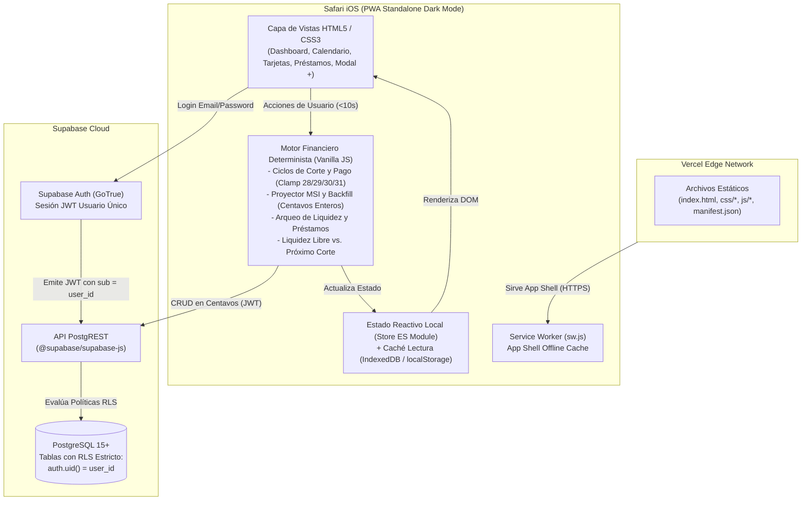

# Slice: Especificación Técnica y Arquitectura de Gestor Financiero Personal (PWA)

*   **Author:** Angel Gabriel Castillo Castillo
*   **Status:** Draft
*   **Date:** 2026-11-18

--------------------------------------------------------------------------------

## Overview

Slice es una aplicación web progresiva (PWA) de uso personal en pesos mexicanos (`MXN`), diseñada con estética *dark-mode* minimalista y enfoque *mobile-first* para Safari en iPhone. Su propósito es centralizar el control de múltiples cuentas de liquidez (efectivo y cuentas de débito), ingresos, gastos diarios, arqueos rápidos de saldo, préstamos a terceros (*"Me deben"*), gastos fijos recurrentes, ciclos de facturación de tarjetas de crédito (fechas de corte, fechas límite de pago y reembolsos) y compras a Meses Sin Intereses (MSI).

La aplicación opera sobre una arquitectura cliente estática construida con HTML5, CSS3 y JavaScript puro (Vanilla JS con ES Modules, sin frameworks), conectada directamente desde el navegador a Supabase (PostgreSQL + Supabase Auth) protegida mediante políticas de Row Level Security (RLS) para un único usuario propietario, y desplegada en Vercel.

## The Problem

Las hojas de cálculo manuales y las aplicaciones comerciales de finanzas personales fallan al modelar la operación diaria de liquidez y tarjetas de crédito en México en seis aspectos concretos:

1.  **Mezcla entre flujo de efectivo exigible en el mes y deuda devengada para cortes futuros:** La mayoría de los gestores restan del efectivo disponible cualquier compra con tarjeta de crédito en el instante de la transacción, o ignoran los estados de cuenta que cerraron el mes anterior y cuya fecha límite de pago vence en el mes en curso. Además, agrupan todo el dinero en una sola bolsa ficticia en lugar de separar el efectivo físico de cada cuenta bancaria de débito.
2.  **Fricción al registrar ingresos variables o conciliar saldos omitidos:** Cuando un usuario recibe ingresos variables a lo largo de la semana y olvida registrar micro-movimientos, reconstruir el historial transacción por transacción toma demasiado tiempo. Sin una herramienta de arqueo rápido (*"Cuadrar Saldo"*) por cuenta de liquidez, el usuario abandona el registro por descuadre acumulado.
3.  **Distorsión de liquidez por préstamos a terceros (*"Me deben"*):** Prestar dinero desde una cuenta de débito o efectivo reduce de inmediato la liquidez disponible para pagar obligaciones del mes, aunque el patrimonio neto no haya disminuido. Si un préstamo no se descuenta de la liquidez activa al otorgarse y se restaura gradualmente conforme se reciben abonos parciales, el saldo libre mostrado resulta falso.
4.  **Desfase en compras realizadas en día de corte (cargos en tránsito) y reembolsos en tarjeta:** En la banca mexicana, la fecha de corte es inclusiva (`día_compra <= día_corte` entra al ciclo que cierra ese día), pero las compras realizadas el día de corte por la tarde suelen procesarse al día siguiente y pasar al próximo estado de cuenta. Asimismo, las devoluciones o bonificaciones reducen el saldo del ciclo activo o generan saldo a favor que debe reflejarse contra el estado de cuenta bancario.
5.  **Proyección inexacta y carga histórica de Meses Sin Intereses (MSI):** Registrar compras a 3, 6, 9, 12, 18 o 24 MSI requiere dividir el monto total en parcialidades mensuales sin pérdida de centavos, distinguir entre la línea de crédito total comprometida y la mensualidad exigible en el ciclo activo, y permitir la carga inicial (*backfill*) de compras a MSI originadas en meses previos (ej. iniciar en la parcialidad $X$ de $N$).
6.  **Doble conteo en gastos fijos pagados con tarjeta de crédito:** Cuando una suscripción recurrente se cobra automáticamente a una tarjeta de crédito, contabilizarla como salida de efectivo de gasto fijo y simultáneamente como deuda de la tarjeta duplica el egreso proyectado del mes.

Slice resuelve estos problemas mediante un libro mayor multimoneda-única (`MXN` en centavos enteros) con cuentas de liquidez separadas, arqueo instantáneo por diferencia, control de cuentas por cobrar y un motor determinista de ciclos de facturación de tarjetas de crédito.

## Goals

*   **Captura móvil en menos de 10 segundos:** Permitir el registro completo de un ingreso, gasto de contado, compra o reembolso con tarjeta (contado o MSI), préstamo a tercero o arqueo de saldo desde Safari en iPhone en un máximo de 4 interacciones táctiles y menos de 10 segundos.
*   **Gestión de múltiples cuentas de liquidez y arqueo rápido (*"Cuadrar Saldo"*):**
    *   Permitir dar de alta múltiples cuentas de liquidez (ej. `Efectivo Físico`, `Débito Banco A`, `Débito Banco B`), mostrando en el dashboard tanto el **Total Líquido** consolidado como el saldo individual de cada cuenta.
    *   Vincular todo ingreso, gasto de contado, pago de tarjeta, préstamo otorgado o abono recibido a la cuenta de liquidez específica donde ocurrió.
    *   Incluir la acción **"Cuadrar Saldo"** por cuenta: al ingresar el saldo real observado (ej. en un corte semanal de sábado), el sistema calcula la diferencia contra el saldo registrado (`delta = saldo_real - saldo_sistema`) y genera automáticamente un movimiento de ajuste (`balance_adjustment`) para cuadrar la cuenta y la liquidez libre al centavo.
*   **Módulo de préstamos a terceros (*"Me deben"*):**
    *   Registrar préstamos otorgados indicando nombre del contacto, monto, cuenta de liquidez de origen y fecha.
    *   Descontar de inmediato el monto prestado de la cuenta de origen (reduciendo el **Total Líquido** y la **Liquidez Libre del Mes**) y sumarlo al indicador independiente **Total por Cobrar**.
    *   Soportar abonos parciales y liquidación total vinculados a una cuenta de liquidez destino, incrementando la liquidez disponible y reduciendo el saldo pendiente del contacto hasta cerrarlo.
*   **Cálculo determinista de ciclos de tarjeta de crédito, MSI y reembolsos:**
    *   Calcular para cada tarjeta su fecha de último corte, próximo corte y fecha límite de pago, ajustando días 30 y 31 al último día válido del mes en meses cortos (febrero con 28/29 días y meses de 30 días).
    *   Asignar por defecto toda compra o reembolso con `día <= día_corte` al ciclo que cierra ese día y `día > día_corte` al siguiente ciclo, con el selector manual *"Diferir al siguiente corte"* para cargos en tránsito.
    *   Soportar el registro de reembolsos o bonificaciones en tarjeta de crédito, restando su importe del ciclo activo (y mostrando **Saldo a Favor** si los reembolsos superan los cargos del ciclo, sin inflar el efectivo de las cuentas de débito).
    *   Distribuir compras a MSI (3, 6, 9, 12, 18, 24 meses) en centavos enteros, asignando el residuo (`total_cents % N`) a la primera parcialidad generada, y soportar *backfill* indicando la parcialidad inicial actual ($X$ de $N$) para proyectar sólo las parcialidades $X \dots N$ hacia adelante.
*   **Separación contable sin doble conteo en el Dashboard:**
    *   Inyectar automáticamente los gastos fijos asociados a tarjeta de crédito dentro del ciclo activo de dicha tarjeta, excluyéndolos de las salidas directas en efectivo/débito.
    *   Presentar cuatro indicadores financieros primarios separados:
        1.  **Total Líquido (Desglosado por Cuenta):** Suma de los saldos actuales reales de todas las cuentas de efectivo y débito activas (que ya reflejan ingresos, gastos de contado, pagos de tarjeta realizados, préstamos netos otorgados y ajustes de arqueo).
        2.  **Liquidez Libre del Mes:** `Total Líquido Actual` $-$ `Pagos pendientes de estados de cuenta de tarjetas cuya fecha límite vence en el mes en curso` $-$ `Gastos fijos pendientes del mes asociados a cuentas de efectivo/débito`.
        3.  **Acumulado Próximo Corte:** Suma de compras de contado $+$ gastos fijos con cargo a tarjeta $+$ parcialidades MSI del ciclo activo $-$ reembolsos en tarjeta del ciclo activo.
        4.  **Deuda Total Comprometida MSI y Total por Cobrar:** Indicadores patrimoniales separados para la suma de parcialidades MSI futuras pendientes de liquidar y el saldo vigente que terceros deben al usuario.
*   **Calendario financiero mensual interactivo:** Visualizar en una cuadrícula mensual las fechas de corte, fechas límite de pago por tarjeta y vencimientos de gastos fijos con su estado (`pendiente` o `pagado`).
*   **Aislamiento de datos para usuario único:** Restringir todas las tablas de Supabase exclusivamente al `auth.uid()` del propietario mediante políticas de Row Level Security (RLS).

## Non-Goals

*   **Integración con pasarelas de pago u Open Banking:** No se integrará Stripe, Plaid, Belvo ni conexiones automatizadas con bancos.
*   **Soporte multi-usuario, multi-tenant o SaaS:** No se diseñarán flujos de registro público abierto, roles compartidos ni suscripciones comerciales.
*   **Soporte multi-divisa:** Todas las operaciones se almacenan, procesan y muestran en pesos mexicanos (`MXN`).
*   **Cálculo de intereses ordinarios o moratorios en tarjetas o préstamos:** El motor de tarjetas asume perfil "totalero" y compras a MSI; el módulo *"Me deben"* registra préstamos personales sin devengo de intereses.
*   **Frameworks de frontend o compilación SSR:** No se utilizará React, Next.js, Vue ni Angular; la aplicación se construirá en HTML5, CSS3 y Vanilla JS (ES Modules) desplegada como sitio estático en Vercel.

## Open Questions

*   Ninguna en esta etapa. Todas las reglas de negocio sobre cuentas de liquidez múltiples, arqueo semanal, préstamos a terceros, reembolsos en tarjeta, regla inclusiva de corte, *backfill* de MSI y stack tecnológico quedaron cerradas.

## Critical User Journeys (CUJs)

### CUJ 1: Registro Rápido de Compra en Día de Corte con Cargo en Tránsito y Reembolso

*   **Given**: El usuario tiene abierta la PWA de Slice en Safari para iPhone. Existe la tarjeta "TDC Banco A" con `día_corte = 15` y `día_pago = 5`. Hoy es 15 de noviembre de 2026 y el ciclo activo acumula `$2,000.00 MXN`.
*   **When**:
    1.  El usuario registra una compra de `$1,200.00 MXN` con `TDC Banco A` a `Contado` y activa el toggle *"Diferir al siguiente corte"* porque compró por la noche.
    2.  Registra además un `Reembolso en Tarjeta` por `$300.00 MXN` en `TDC Banco A` con fecha 15 de noviembre sin diferir.
*   **Then**:
    *   La compra de `$1,200.00` se asigna al ciclo `2026-11-16` $\rightarrow$ `2026-12-15` (pago el `2027-01-05`).
    *   El reembolso de `$300.00` entra al ciclo que cierra hoy (`2026-11-15`), reduciendo el saldo a pagar del corte de noviembre de `$2,000.00` a `$1,700.00 MXN`.
    *   Ninguno de los dos movimientos altera los saldos de las cuentas de efectivo/débito hasta que el usuario registre el pago del estado de cuenta desde una cuenta de liquidez específica.

### CUJ 2: Registro de Compra a MSI con División Inexacta y Backfill Preexistente

*   **Given**: El usuario registra una compra realizada meses atrás por `$10,000.00 MXN` a `12 MSI` en la tarjeta "TDC Banco B" (`día_corte = 20`, `día_pago = 10`), donde hoy corresponde pagar la parcialidad 4 de 12.
*   **When**: En el modal de gasto con tarjeta ingresa `$10,000.00 MXN`, modalidad `MSI`, plazo `12 meses` y `Parcialidad inicial = 4`.
*   **Then**:
    *   El motor convierte el total a `1,000,000` centavos, calcula la cuota base `floor(1000000 / 12) = 83,333` centavos (`$833.33`) y el residuo `4` centavos (`$0.04`).
    *   Como `start_installment = 4 > 1`, el residuo de `$0.04` se asume liquidado en la parcialidad histórica `1/12`. Por tanto, el sistema genera únicamente las 9 parcialidades pendientes (`4/12` a `12/12`) desde el ciclo activo hacia los 8 ciclos futuros usando la cuota base exacta de `$833.33 MXN` (permitiendo además editar manualmente el monto de cualquier parcialidad si el estado de cuenta bancario aplicó un redondeo distinto).
    *   En el ciclo activo sólo se suma `$833.33` al **Acumulado Próximo Corte**, y la **Deuda Total Comprometida MSI** refleja exactamente la suma de las 9 parcialidades vigentes (`$7,499.97`).

### CUJ 3: Gasto Fijo Recurrente Asociado a Tarjeta de Crédito vs. Cuenta de Débito

*   **Given**: Existen dos gastos fijos mensuales:
    1.  "Suscripción IA" por `$100.00 MXN`, día de cobro `8`, método de pago: `TDC Banco B`.
    2.  "Gimnasio" por `$250.00 MXN`, día de cobro `1`, método de pago: cuenta de liquidez `Débito Banco A`.
*   **When**: Inicia el mes de noviembre de 2026 con ambos gastos en estado `pendiente`, y posteriormente el usuario marca "Gimnasio" como `pagado` desde `Débito Banco A`.
*   **Then**:
    *   Mientras "Gimnasio" estaba `pendiente`, los `$250.00` se restaban en **Liquidez Libre del Mes** como gasto fijo pendiente de efectivo/débito. Al marcarse como `pagado`, se inserta el egreso en `Débito Banco A` (reduciendo `Total Líquido` en `$250.00`) y deja de estar `pendiente`, por lo que la **Liquidez Libre del Mes** permanece invariante sin duplicar la resta.
    *   "Suscripción IA" (`$100.00`, `TDC Banco B`) se suma automáticamente al **Acumulado Próximo Corte** de `TDC Banco B` y nunca se descuenta de las cuentas de débito como gasto fijo directo.

### CUJ 4: Arqueo Semanal ("Cuadrar Saldo") en Cuenta de Liquidez

*   **Given**: La cuenta `Efectivo Físico` muestra en Slice un saldo registrado de `$1,450.00 MXN`, y la cuenta `Débito Banco A` muestra `$8,200.00 MXN` (`Total Líquido = $9,650.00 MXN`). Durante la semana el usuario recibió ingresos variables en efectivo y realizó gastos menores no registrados; al contar su cartera el sábado tiene `$2,100.00 MXN` reales en `Efectivo Físico`.
*   **When**: El usuario pulsa **"Cuadrar Saldo"** en la tarjeta de `Efectivo Físico` e ingresa `$2,100.00 MXN`.
*   **Then**:
    *   El sistema calcula la diferencia: `+$650.00 MXN` (`+65,000` centavos).
    *   Genera una transacción de tipo `balance_adjustment` en `Efectivo Físico` por `+$650.00 MXN` con nota automática `"Arqueo de saldo (previo: $1,450.00 -> real: $2,100.00)"`.
    *   El saldo de `Efectivo Físico` pasa a `$2,100.00 MXN`, el **Total Líquido** sube a `$10,300.00 MXN`, y la **Liquidez Libre del Mes** aumenta en `+$650.00 MXN` de inmediato.

### CUJ 5: Préstamo a un Tercero ("Me deben") y Abono Parcial

*   **Given**: El usuario tiene `$8,200.00 MXN` en `Débito Banco A` y una **Liquidez Libre del Mes** de `$5,000.00 MXN`. El indicador **Total por Cobrar** está en `$0.00 MXN`.
*   **When**:
    1.  El usuario registra un préstamo a `"Contacto A"` por `$1,000.00 MXN` saliendo de `Débito Banco A`.
    2.  Tres días después, `"Contacto A"` le paga `$400.00 MXN` en efectivo, y el usuario registra un abono parcial de `$400.00 MXN` entrando a la cuenta `Efectivo Físico`.
*   **Then**:
    *   Al otorgar el préstamo, el saldo de `Débito Banco A` baja a `$7,200.00 MXN`, la **Liquidez Libre del Mes** baja a `$4,000.00 MXN` y **Total por Cobrar** sube a `$1,000.00 MXN`.
    *   Al registrar el abono de `$400.00 MXN` en `Efectivo Físico`, el saldo de `Efectivo Físico` y la **Liquidez Libre del Mes** aumentan en `+$400.00 MXN`, mientras que **Total por Cobrar** disminuye a `$600.00 MXN` (dejando el préstamo de `"Contacto A"` activo con saldo pendiente de `$600.00 MXN`).

### CUJ 6: Ajuste de Fechas de Corte y Pago en Meses Cortos (Febrero)

*   **Given**: Existe la tarjeta "TDC Banco C" con `día_corte = 31` y `día_pago = 20`.
*   **When**: El usuario consulta el calendario financiero y el ciclo de facturación de febrero de 2027 (28 días).
*   **Then**:
    *   El motor aplica `min(31, 28) = 28`, fijando la fecha de corte en `2027-02-28` y la fecha límite de pago en `2027-03-20`.
    *   El calendario mensual posiciona el indicador de corte en la celda del 28 de febrero sin desbordamiento de fecha.

--------------------------------------------------------------------------------

## Technical Plan (Architecture)

### 1. Arquitectura de Alto Nivel y Flujo de Datos

Slice utiliza una arquitectura de cliente estático (*Thick Client PWA*) sin servidor intermedio propio (Backend-as-a-Service vía Supabase). Todo el cálculo de ciclos de facturación, proyecciones de MSI, arqueos y agregaciones del dashboard se ejecuta de forma determinista en módulos de JavaScript puro en el navegador sobre los registros obtenidos de PostgreSQL.



#### Decisiones Arquitectónicas Principales

1.  **Aritmética exclusiva en centavos enteros (`BIGINT` en PostgreSQL / `Number` entero en JS):**
    *   Ningún monto monetario se almacena ni se opera en punto flotante (`FLOAT` o `Number` decimal). Un monto de `$1,250.50 MXN` se almacena como `125050`.
    *   La conversión a formato legible (`$1,250.50`) ocurre exclusivamente en la capa de presentación mediante `Intl.NumberFormat('es-MX', { style: 'currency', currency: 'MXN' })`.
2.  **Materialización de Parcialidades MSI en Base de Datos (`msi_installments`):**
    *   Al registrar una compra a MSI (o un *backfill* desde la parcialidad $X$ de $N$), el motor genera en una sola transacción las filas individuales en `msi_installments`, cada una vinculada al mes-ciclo exacto (`cycle_year_month`, ej. `'2026-12'`) al que pertenece.
    *   Esto permite consultar el total de cualquier ciclo presente o futuro mediante una suma simple (`SUM(amount_cents)`), permite auditar cada parcialidad individualmente y garantiza que la suma de parcialidades pendientes sea exacta al centavo.
3.  **Libro Mayor Basado en Cuentas de Liquidez (`liquidity_accounts` + `transactions`):**
    *   El saldo actual de cada cuenta de efectivo o débito se deriva de su saldo inicial más la suma firmada de todas sus transacciones asociadas en la tabla `transactions` (o vista SQL `v_liquidity_account_balances`).
    *   Operaciones compuestas (como otorgar un préstamo, recibir un abono de préstamo, pagar el estado de cuenta de una tarjeta o ejecutar un arqueo con *"Cuadrar Saldo"*) escriben un registro trazable en `transactions` que impacta directamente la cuenta de liquidez involucrada.

### 2. Estructura Modular del Cliente (Vanilla JS + PWA Mobile-First)

La interfaz está optimizada para el viewport de Safari en iPhone en modo instalado (*Add to Home Screen*):

*   **Configuración de Entorno sin Bundler (`js/config.js`):**
    *   Al ejecutarse como ES Modules nativos en el navegador sin un *bundler* (sin Vite, Webpack ni Next.js), el entorno de ejecución no dispone de `process.env` ni sustitución en tiempo de compilación.
    *   Las credenciales públicas de conexión (`SUPABASE_URL` y `SUPABASE_ANON_KEY`) se exportan como constantes en un módulo dedicado `js/config.js`. Dado que la llave `anon` de Supabase es pública por diseño para clientes web, la protección de los datos recae en las políticas de Row Level Security (`auth.uid() = user_id`) en PostgreSQL y en mantener deshabilitado el registro de nuevos usuarios en Supabase Auth.
*   **Configuración PWA para iOS:**
    *   `<meta name="viewport" content="width=device-width, initial-scale=1, maximum-scale=1, user-scalable=no, viewport-fit=cover">` para evitar zoom accidental al enfocar inputs numéricos y cubrir el área del *notch* / *Dynamic Island*.
    *   `<meta name="apple-mobile-web-app-capable" content="yes">` y `<meta name="apple-mobile-web-app-status-bar-style" content="black-translucent">`.
    *   Uso de variables CSS `env(safe-area-inset-top)` y `env(safe-area-inset-bottom)` en la barra de navegación inferior donde reside el botón central de acción rápida (`+`).
    *   Teclado numérico nativo en iPhone mediante `inputmode="decimal"` en el campo de monto, con foco automático al abrir el modal de captura rápida.
*   **Paleta y Tokens Visuales Dark-Mode Minimalista:**
    *   Fondo primario OLED: `#09090B` (`--bg-primary`), superficies elevadas: `#121215` (`--bg-surface`), bordes sutiles: `#27272A` (`--border-subtle`).
    *   Tipografía: pila nativa del sistema `-apple-system, BlinkMacSystemFont, "SF Pro Display", "SF Pro Text", sans-serif` con `font-variant-numeric: tabular-nums` en todas las cifras monetarias para alineación vertical de dígitos.
    *   Semántica de color: Liquidez/Ingreso `#10B981` (verde esmeralda), Gasto/Deuda exigible `#F43F5E` (rojo coral), MSI/Ciclo futuro `#38BDF8` (azul cielo), Préstamos por cobrar `#F59E0B` (ámbar).

### 3. Modelo de Datos Relacional y Esquema SQL (PostgreSQL en Supabase)

El siguiente esquema define todas las tablas, restricciones de integridad e índices en PostgreSQL:

```sql
-- Extensión para generación de UUIDs v4
CREATE EXTENSION IF NOT EXISTS "pgcrypto";

-- ============================================================================
-- 1. CUENTAS DE LIQUIDEZ (Efectivo Físico, Débito Banco A, Débito Banco B)
-- ============================================================================
CREATE TABLE public.liquidity_accounts (
    id UUID PRIMARY KEY DEFAULT gen_random_uuid(),
    user_id UUID NOT NULL REFERENCES auth.users(id) ON DELETE CASCADE,
    name TEXT NOT NULL CHECK (char_length(trim(name)) > 0),
    account_type TEXT NOT NULL CHECK (account_type IN ('cash', 'debit')),
    color_hex TEXT NOT NULL DEFAULT '#10B981',
    initial_balance_cents BIGINT NOT NULL DEFAULT 0,
    is_archived BOOLEAN NOT NULL DEFAULT FALSE,
    sort_order INTEGER NOT NULL DEFAULT 0,
    created_at TIMESTAMPTZ NOT NULL DEFAULT now()
);

-- ============================================================================
-- 2. TARJETAS DE CRÉDITO
-- ============================================================================
CREATE TABLE public.credit_cards (
    id UUID PRIMARY KEY DEFAULT gen_random_uuid(),
    user_id UUID NOT NULL REFERENCES auth.users(id) ON DELETE CASCADE,
    name TEXT NOT NULL CHECK (char_length(trim(name)) > 0),
    bank_name TEXT NOT NULL CHECK (char_length(trim(bank_name)) > 0),
    color_hex TEXT NOT NULL DEFAULT '#38BDF8',
    credit_limit_cents BIGINT CHECK (credit_limit_cents IS NULL OR credit_limit_cents >= 0),
    cutoff_day SMALLINT NOT NULL CHECK (cutoff_day BETWEEN 1 AND 31),
    payment_due_day SMALLINT NOT NULL CHECK (payment_due_day BETWEEN 1 AND 31),
    is_archived BOOLEAN NOT NULL DEFAULT FALSE,
    sort_order INTEGER NOT NULL DEFAULT 0,
    created_at TIMESTAMPTZ NOT NULL DEFAULT now()
);

-- ============================================================================
-- 3. CATEGORÍAS DE MOVIMIENTO
-- ============================================================================
CREATE TABLE public.categories (
    id UUID PRIMARY KEY DEFAULT gen_random_uuid(),
    user_id UUID NOT NULL REFERENCES auth.users(id) ON DELETE CASCADE,
    name TEXT NOT NULL CHECK (char_length(trim(name)) > 0),
    kind TEXT NOT NULL CHECK (kind IN ('income', 'expense', 'system')),
    icon TEXT NOT NULL DEFAULT 'tag',
    sort_order INTEGER NOT NULL DEFAULT 0,
    created_at TIMESTAMPTZ NOT NULL DEFAULT now()
);

-- ============================================================================
-- 4. PLANES DE MESES SIN INTERESES (Cabecera de Compra MSI + Soporte Backfill)
-- ============================================================================
CREATE TABLE public.msi_plans (
    id UUID PRIMARY KEY DEFAULT gen_random_uuid(),
    user_id UUID NOT NULL REFERENCES auth.users(id) ON DELETE CASCADE,
    credit_card_id UUID NOT NULL REFERENCES public.credit_cards(id) ON DELETE RESTRICT,
    category_id UUID REFERENCES public.categories(id) ON DELETE SET NULL,
    description TEXT NOT NULL CHECK (char_length(trim(description)) > 0),
    purchase_date DATE NOT NULL,
    defer_to_next_cycle BOOLEAN NOT NULL DEFAULT FALSE,
    total_amount_cents BIGINT NOT NULL CHECK (total_amount_cents > 0),
    total_months SMALLINT NOT NULL CHECK (total_months IN (3, 6, 9, 12, 18, 24)),
    start_installment SMALLINT NOT NULL DEFAULT 1 CHECK (start_installment >= 1 AND start_installment <= total_months),
    first_active_cycle_ym CHAR(7) NOT NULL CHECK (first_active_cycle_ym ~ '^[0-9]{4}-[0-9]{2}$'),
    status TEXT NOT NULL DEFAULT 'active' CHECK (status IN ('active', 'completed', 'cancelled')),
    created_at TIMESTAMPTZ NOT NULL DEFAULT now()
);

-- ============================================================================
-- 5. PARCIALIDADES PROYECTADAS DE MSI (Una fila por parcialidad activa X..N)
-- ============================================================================
CREATE TABLE public.msi_installments (
    id UUID PRIMARY KEY DEFAULT gen_random_uuid(),
    user_id UUID NOT NULL REFERENCES auth.users(id) ON DELETE CASCADE,
    msi_plan_id UUID NOT NULL REFERENCES public.msi_plans(id) ON DELETE CASCADE,
    credit_card_id UUID NOT NULL REFERENCES public.credit_cards(id) ON DELETE RESTRICT,
    installment_number SMALLINT NOT NULL CHECK (installment_number >= 1),
    total_installments SMALLINT NOT NULL CHECK (total_installments IN (3, 6, 9, 12, 18, 24)),
    cycle_year_month CHAR(7) NOT NULL CHECK (cycle_year_month ~ '^[0-9]{4}-[0-9]{2}$'),
    cycle_cutoff_date DATE NOT NULL,
    payment_due_date DATE NOT NULL,
    amount_cents BIGINT NOT NULL CHECK (amount_cents > 0),
    is_settled BOOLEAN NOT NULL DEFAULT FALSE,
    UNIQUE (msi_plan_id, installment_number)
);

-- ============================================================================
-- 6. GASTOS FIJOS Y SUSCRIPCIONES RECURRENTES
-- ============================================================================
CREATE TABLE public.recurring_expenses (
    id UUID PRIMARY KEY DEFAULT gen_random_uuid(),
    user_id UUID NOT NULL REFERENCES auth.users(id) ON DELETE CASCADE,
    name TEXT NOT NULL CHECK (char_length(trim(name)) > 0),
    category_id UUID REFERENCES public.categories(id) ON DELETE SET NULL,
    amount_cents BIGINT NOT NULL CHECK (amount_cents > 0),
    billing_day SMALLINT NOT NULL CHECK (billing_day BETWEEN 1 AND 31),
    payment_method_type TEXT NOT NULL CHECK (payment_method_type IN ('liquidity_account', 'credit_card')),
    liquidity_account_id UUID REFERENCES public.liquidity_accounts(id) ON DELETE RESTRICT,
    credit_card_id UUID REFERENCES public.credit_cards(id) ON DELETE RESTRICT,
    is_active BOOLEAN NOT NULL DEFAULT TRUE,
    created_at TIMESTAMPTZ NOT NULL DEFAULT now(),
    CONSTRAINT chk_recurring_payment_target CHECK (
        (payment_method_type = 'liquidity_account' AND liquidity_account_id IS NOT NULL AND credit_card_id IS NULL) OR
        (payment_method_type = 'credit_card' AND credit_card_id IS NOT NULL AND liquidity_account_id IS NULL)
    )
);

-- ============================================================================
-- 7. PRÉSTAMOS A TERCEROS ("ME DEBEN")
-- ============================================================================
CREATE TABLE public.loans (
    id UUID PRIMARY KEY DEFAULT gen_random_uuid(),
    user_id UUID NOT NULL REFERENCES auth.users(id) ON DELETE CASCADE,
    borrower_name TEXT NOT NULL CHECK (char_length(trim(borrower_name)) > 0),
    description TEXT,
    origin_account_id UUID NOT NULL REFERENCES public.liquidity_accounts(id) ON DELETE RESTRICT,
    loan_date DATE NOT NULL,
    principal_cents BIGINT NOT NULL CHECK (principal_cents > 0),
    repaid_cents BIGINT NOT NULL DEFAULT 0 CHECK (repaid_cents >= 0 AND repaid_cents <= principal_cents),
    status TEXT NOT NULL DEFAULT 'active' CHECK (status IN ('active', 'settled')),
    created_at TIMESTAMPTZ NOT NULL DEFAULT now()
);

-- ============================================================================
-- 8. LIBRO MAYOR DE TRANSACCIONES (Ingresos, Gastos, TDC Contado/Reembolso,
--    Pagos de Tarjeta, Arqueos de Saldo, Préstamos y Abonos)
-- ============================================================================
CREATE TABLE public.transactions (
    id UUID PRIMARY KEY DEFAULT gen_random_uuid(),
    user_id UUID NOT NULL REFERENCES auth.users(id) ON DELETE CASCADE,
    tx_type TEXT NOT NULL CHECK (tx_type IN (
        'income',               -- Ingreso a cuenta de liquidez (+)
        'liquidity_expense',    -- Gasto de contado desde efectivo/débito (-)
        'card_charge',          -- Compra de contado con tarjeta de crédito (+deuda TDC)
        'card_refund',          -- Reembolso o bonificación en tarjeta (-deuda TDC)
        'card_payment',         -- Pago a tarjeta desde cuenta de liquidez (-liquidez, -estado de cuenta)
        'account_transfer',     -- Traspaso entre dos cuentas de liquidez
        'balance_adjustment',   -- Ajuste por arqueo rápido ("Cuadrar Saldo", + o -)
        'loan_disbursement',    -- Salida de efectivo/débito por préstamo otorgado (-)
        'loan_repayment'        -- Entrada de efectivo/débito por abono de préstamo (+)
    )),
    tx_date DATE NOT NULL,
    amount_cents BIGINT NOT NULL CHECK (amount_cents > 0),
    -- Para balance_adjustment se define el signo del ajuste ('inflow' suma, 'outflow' resta)
    adjustment_direction TEXT CHECK (adjustment_direction IN ('inflow', 'outflow')),
    liquidity_account_id UUID REFERENCES public.liquidity_accounts(id) ON DELETE RESTRICT,
    target_liquidity_account_id UUID REFERENCES public.liquidity_accounts(id) ON DELETE RESTRICT,
    credit_card_id UUID REFERENCES public.credit_cards(id) ON DELETE RESTRICT,
    -- Campos de ciclo para transacciones de tarjeta (card_charge, card_refund, card_payment)
    defer_to_next_cycle BOOLEAN NOT NULL DEFAULT FALSE,
    assigned_cycle_ym CHAR(7) CHECK (assigned_cycle_ym IS NULL OR assigned_cycle_ym ~ '^[0-9]{4}-[0-9]{2}$'),
    cycle_cutoff_date DATE,
    payment_due_date DATE,
    -- Vínculos opcionales a gastos fijos o préstamos
    category_id UUID REFERENCES public.categories(id) ON DELETE SET NULL,
    recurring_expense_id UUID REFERENCES public.recurring_expenses(id) ON DELETE SET NULL,
    loan_id UUID REFERENCES public.loans(id) ON DELETE CASCADE,
    description TEXT NOT NULL DEFAULT '',
    metadata JSONB NOT NULL DEFAULT '{}'::jsonb,
    created_at TIMESTAMPTZ NOT NULL DEFAULT now(),
    CONSTRAINT chk_tx_consistency_by_type CHECK (
        (tx_type IN ('income', 'liquidity_expense')
            AND liquidity_account_id IS NOT NULL
            AND target_liquidity_account_id IS NULL
            AND credit_card_id IS NULL
            AND adjustment_direction IS NULL)
        OR
        (tx_type IN ('card_charge', 'card_refund')
            AND credit_card_id IS NOT NULL
            AND assigned_cycle_ym IS NOT NULL
            AND liquidity_account_id IS NULL
            AND target_liquidity_account_id IS NULL
            AND adjustment_direction IS NULL)
        OR
        (tx_type = 'card_payment'
            AND liquidity_account_id IS NOT NULL
            AND credit_card_id IS NOT NULL
            AND assigned_cycle_ym IS NOT NULL
            AND target_liquidity_account_id IS NULL
            AND adjustment_direction IS NULL)
        OR
        (tx_type = 'account_transfer'
            AND liquidity_account_id IS NOT NULL
            AND target_liquidity_account_id IS NOT NULL
            AND liquidity_account_id <> target_liquidity_account_id
            AND credit_card_id IS NULL
            AND adjustment_direction IS NULL)
        OR
        (tx_type = 'balance_adjustment'
            AND liquidity_account_id IS NOT NULL
            AND adjustment_direction IS NOT NULL
            AND target_liquidity_account_id IS NULL
            AND credit_card_id IS NULL)
        OR
        (tx_type IN ('loan_disbursement', 'loan_repayment')
            AND liquidity_account_id IS NOT NULL
            AND loan_id IS NOT NULL
            AND target_liquidity_account_id IS NULL
            AND credit_card_id IS NULL
            AND adjustment_direction IS NULL)
    )
);

-- ============================================================================
-- 9. CONTROL MENSUAL DE GASTOS FIJOS (Pendiente vs. Pagado por Mes)
-- ============================================================================
CREATE TABLE public.recurring_expense_logs (
    id UUID PRIMARY KEY DEFAULT gen_random_uuid(),
    user_id UUID NOT NULL REFERENCES auth.users(id) ON DELETE CASCADE,
    recurring_expense_id UUID NOT NULL REFERENCES public.recurring_expenses(id) ON DELETE CASCADE,
    year_month CHAR(7) NOT NULL CHECK (year_month ~ '^[0-9]{4}-[0-9]{2}$'),
    due_date DATE NOT NULL,
    amount_cents BIGINT NOT NULL CHECK (amount_cents > 0),
    status TEXT NOT NULL DEFAULT 'pending' CHECK (status IN ('pending', 'paid', 'skipped')),
    transaction_id UUID REFERENCES public.transactions(id) ON DELETE SET NULL,
    paid_at TIMESTAMPTZ,
    UNIQUE (recurring_expense_id, year_month)
);

-- ============================================================================
-- ÍNDICES DE RENDIMIENTO
-- ============================================================================
CREATE INDEX idx_tx_user_date ON public.transactions (user_id, tx_date DESC);
CREATE INDEX idx_tx_user_card_cycle ON public.transactions (user_id, credit_card_id, assigned_cycle_ym);
CREATE INDEX idx_tx_user_liquidity ON public.transactions (user_id, liquidity_account_id);
CREATE INDEX idx_msi_inst_user_card_cycle ON public.msi_installments (user_id, credit_card_id, cycle_year_month);
CREATE INDEX idx_rec_logs_user_ym ON public.recurring_expense_logs (user_id, year_month);
CREATE INDEX idx_loans_user_status ON public.loans (user_id, status);
```

### 4. Privacidad y Seguridad: Autenticación y Row Level Security (RLS)

Al desplegarse como una URL pública en Vercel, la seguridad reside en dos controles obligatorios en Supabase:

1.  **Desactivación de Registro Público en Supabase Auth:** En la configuración de Supabase Auth (`Authentication -> Providers -> Email`), se desactiva `Allow new users to sign up` una vez creada la cuenta única del propietario.
2.  **Políticas RLS Estrictas por `auth.uid()`:** Todas las tablas tienen RLS habilitado con rechazo por defecto para el rol `anon`. Únicamente un JWT válido del rol `authenticated` cuyo `auth.uid()` coincida con `user_id` puede leer o modificar filas:

```sql
-- Habilitar RLS en todas las tablas del esquema public
ALTER TABLE public.liquidity_accounts ENABLE ROW LEVEL SECURITY;
ALTER TABLE public.credit_cards ENABLE ROW LEVEL SECURITY;
ALTER TABLE public.categories ENABLE ROW LEVEL SECURITY;
ALTER TABLE public.msi_plans ENABLE ROW LEVEL SECURITY;
ALTER TABLE public.msi_installments ENABLE ROW LEVEL SECURITY;
ALTER TABLE public.recurring_expenses ENABLE ROW LEVEL SECURITY;
ALTER TABLE public.recurring_expense_logs ENABLE ROW LEVEL SECURITY;
ALTER TABLE public.loans ENABLE ROW LEVEL SECURITY;
ALTER TABLE public.transactions ENABLE ROW LEVEL SECURITY;

-- Plantilla de política unificada (aplicada a cada una de las 9 tablas)
CREATE POLICY "owner_full_access_liquidity_accounts"
    ON public.liquidity_accounts
    FOR ALL
    TO authenticated
    USING (auth.uid() = user_id)
    WITH CHECK (auth.uid() = user_id);

-- (Se replica idénticamente para credit_cards, categories, msi_plans,
--  msi_installments, recurring_expenses, recurring_expense_logs, loans y transactions)
```

### 5. Algoritmos del Motor Financiero y Resolución de Casos Límite

#### 5.1 Ajuste de Días 30 y 31 en Meses Cortos (`clampDayToMonth`)

Para tarjetas con `cutoff_day` o `payment_due_day` en `30` o `31`, y gastos fijos con `billing_day` en `30` o `31`, el motor nunca construye fechas directas sin antes acotar el día al máximo de días del mes destino:

$$\text{effectiveDay}(Y, M, d) = \min\left(d,\; \text{daysInMonth}(Y, M)\right)$$

Donde $\text{daysInMonth}(Y, M)$ en JavaScript se obtiene con `new Date(year, monthOneBased, 0).getDate()`.
*   Ejemplo en año no bisiesto (`2027-02`, 28 días) con `cutoff_day = 31`: $\min(31, 28) = 28 \rightarrow \text{2027-02-28}$.
*   Ejemplo en año bisiesto (`2028-02`, 29 días) con `cutoff_day = 31`: $\min(31, 29) = 29 \rightarrow \text{2028-02-29}$.

#### 5.2 Asignación Exacta al Ciclo de Facturación y Diferimiento Manual

Dado un movimiento en tarjeta con fecha de compra $T = (Y_T, M_T, D_T)$, una tarjeta con día de corte $d_{\text{corte}}$ y día límite de pago $d_{\text{pago}}$, y la bandera booleana `deferToNextCycle`:

1.  **Fecha de corte del mes de la compra:**
    $$C_{\text{mes}} = \text{Date}\left(Y_T, M_T, \text{effectiveDay}(Y_T, M_T, d_{\text{corte}})\right)$$
2.  **Determinación del mes-ciclo base (`baseCycleYM`):**
    *   **Regla inclusiva:** Si $D_T \le \text{effectiveDay}(Y_T, M_T, d_{\text{corte}})$, la compra pertenece al ciclo que corta en el mismo mes $(Y_T, M_T)$.
    *   **Post-corte:** Si $D_T > \text{effectiveDay}(Y_T, M_T, d_{\text{corte}})$, la compra pertenece al ciclo que corta en el mes siguiente $\text{addMonths}((Y_T, M_T), 1)$.
3.  **Aplicación del toggle *"Diferir al siguiente corte"* (cargos en tránsito):**
    *   Si `deferToNextCycle == true`, se avanza un mes adicional al ciclo calculado:
        $$\text{assignedCycleYM} = \text{addMonths}(\text{baseCycleYM}, 1)$$
    *   La fecha oficial de cierre de dicho ciclo es $C_{\text{cierre}} = \text{Date}(Y_C, M_C, \text{effectiveDay}(Y_C, M_C, d_{\text{corte}}))$.
4.  **Cálculo de la Fecha Límite de Pago (`paymentDueDate`) del ciclo $(Y_C, M_C)$:**
    *   Si $d_{\text{pago}} > d_{\text{corte}}$, la fecha límite de pago cae en el **mismo mes** del cierre de corte:
        $$P_{\text{límite}} = \text{Date}\left(Y_C, M_C, \text{effectiveDay}(Y_C, M_C, d_{\text{pago}})\right)$$
    *   Si $d_{\text{pago}} \le d_{\text{corte}}$, la fecha límite de pago cae en el **mes siguiente** al cierre de corte $(Y_{C+}, M_{C+}) = \text{addMonths}((Y_C, M_C), 1)$:
        $$P_{\text{límite}} = \text{Date}\left(Y_{C+}, M_{C+}, \text{effectiveDay}(Y_{C+}, M_{C+}, d_{\text{pago}})\right)$$

#### 5.3 Motor de Meses Sin Intereses (MSI), Residuo de Centavos y Backfill

Cuando se registra un plan MSI por un monto total $A_{\text{total}}$ (en centavos), a $N \in \{3, 6, 9, 12, 18, 24\}$ meses, comenzando en la parcialidad $k_{\text{inicio}} \in [1, N]$ y cuyo primer ciclo activo resuelto por la regla 5.2 es $\text{YM}_0$:

1.  **Cálculo de parcialidad base y residuo en centavos enteros:**
    $$q = \left\lfloor \frac{A_{\text{total}}}{N} \right\rfloor, \quad r = A_{\text{total}} \bmod N$$
2.  **Asignación por número de parcialidad $i \in \{1, \dots, N\}$:**
    $$a_i = \begin{cases} q + r & \text{si } i = 1 \\ q & \text{si } i \in \{2, \dots, N\} \end{cases}$$
    De este modo $\sum_{i=1}^{N} a_i = Nq + r = A_{\text{total}}$ sin pérdida ni creación de centavos.
3.  **Generación con soporte de Backfill ($k_{\text{inicio}} \ge 1$) y edición manual de parcialidad:**
    *   El sistema genera filas en `msi_installments` únicamente para $i \in \{k_{\text{inicio}}, k_{\text{inicio}}+1, \dots, N\}$.
    *   Cuando $k_{\text{inicio}} > 1$, el residuo $r = A_{\text{total}} \bmod N$ se asume liquidado en la primera parcialidad histórica ($i = 1$), por lo que todas las parcialidades proyectadas $i \in \{k_{\text{inicio}}, \dots, N\}$ se inicializan con la cuota base exacta $q = \lfloor A_{\text{total}} / N \rfloor$.
    *   Para cada parcialidad $i$, su desplazamiento de ciclo respecto al ciclo activo actual $\text{YM}_0$ es $\Delta = i - k_{\text{inicio}}$, asignándole el ciclo:
        $$\text{cycleYM}_i = \text{addMonths}(\text{YM}_0, i - k_{\text{inicio}})$$
    *   El usuario puede editar manualmente el campo `amount_cents` de una parcialidad individual en `msi_installments` en caso de que el banco emisor haya aplicado una política de redondeo distinta en su estado de cuenta.

#### 5.4 Ecuaciones Contables del Dashboard (Liquidez, Arqueo, Préstamos, Reembolsos y Gastos Fijos)

1.  **Saldo Actual por Cuenta de Liquidez $c$ (`accountBalanceCents(c)`):**
    $$\text{Saldo}(c) = \text{Inicial}(c) + \sum \text{Ingresos}(c) - \sum \text{GastosContado}(c) - \sum \text{PagosTDC}(c) - \sum \text{PréstamosOtorgados}(c) + \sum \text{AbonosPréstamo}(c) + \sum \text{TraspasosEntrada}(c) - \sum \text{TraspasosSalida}(c) \pm \sum \text{AjustesArqueo}(c)$$
2.  **Total Líquido Consolidado:**
    $$\text{TotalLíquido} = \sum_{c \in \text{CuentasActivas}} \text{Saldo}(c)$$
3.  **Arqueo Rápido (*"Cuadrar Saldo"* en cuenta $c$):**
    Dado el saldo real observado por el usuario $S_{\text{real}}(c)$ y el saldo calculado actual $\text{Saldo}(c)$:
    $$\Delta = S_{\text{real}}(c) - \text{Saldo}(c)$$
    Si $\Delta > 0$, se inserta `tx_type = 'balance_adjustment'`, `adjustment_direction = 'inflow'`, `amount_cents = \Delta`. Si $\Delta < 0$, se inserta con `adjustment_direction = 'outflow'`, `amount_cents = |\Delta|`. Tras la inserción, $\text{Saldo}(c) = S_{\text{real}}(c)$.
4.  **Saldo de Ciclo de Tarjeta $t$ en el Ciclo $\text{YM}$ (`cardCycleBalanceCents(t, YM)`):**
    $$\text{Bruto}(t, \text{YM}) = \sum \text{ComprasContado}(t, \text{YM}) + \sum \text{ParcialidadesMSI}(t, \text{YM}) + \sum \text{GastosFijosTDCPendientes}(t, \text{YM}) - \sum \text{ReembolsosTDC}(t, \text{YM})$$
    *   **Prevención de doble conteo intra-ciclo en tarjeta:** Los gastos fijos vinculados a la tarjeta $t$ cuya fecha de cobro cae en el ciclo $\text{YM}$ se suman como proyección en $\text{GastosFijosTDCPendientes}(t, \text{YM})$ **únicamente mientras su estado en `recurring_expense_logs` sea `pending`**. Cuando el gasto fijo se marca como `paid`, el sistema inserta la transacción real `tx_type = 'card_charge'` en `transactions` (vinculada mediante `recurring_expense_id` y `transaction_id`), pasando de $\text{GastosFijosTDCPendientes}(t, \text{YM})$ a $\text{ComprasContado}(t, \text{YM})$ sin duplicar el cargo en la tarjeta.
    *   Si $\text{Bruto}(t, \text{YM}) < 0$, la tarjeta presenta un **Saldo a Favor** de $|\text{Bruto}(t, \text{YM})|$.
    *   El monto exigible de pago del estado de cuenta cerrado para efectos de salida de efectivo es:
        $$\text{ExigiblePorPagar}(t, \text{YM}) = \max\left(0,\; \text{Bruto}(t, \text{YM}) - \sum \text{PagosRealizadosAlCiclo}(t, \text{YM})\right)$$
5.  **Liquidez Libre del Mes $M$:**
    $$\text{LiquidezLibre}(M) = \text{TotalLíquido} - \sum_{t,\; P_{\text{límite}}(t, \text{YM}) \in M} \text{ExigiblePorPagar}(t, \text{YM}) - \sum_{g \in \text{GastosFijosDébitoPendientes}(M)} \text{Monto}(g)$$
    *(Nota: Los gastos fijos con tarjeta de crédito ya están incluidos dentro de $\text{Bruto}(t, \text{YM})$ del ciclo correspondiente, por lo que no forman parte de $\text{GastosFijosDébitoPendientes}(M)$, eliminando el doble conteo).*
6.  **Indicadores Patrimoniales Independientes:**
    *   **Acumulado Próximo Corte:** $\sum_{t} \max\left(0,\; \text{Bruto}(t, \text{YM}_{\text{activo}}(t))\right)$.
    *   **Deuda Total Comprometida MSI:** $\sum_{t} \sum_{\text{YM} \ge \text{YM}_{\text{activo}}(t)} \text{ParcialidadesMSIPendientes}(t, \text{YM})$.
    *   **Total por Cobrar (*"Me deben"*):** $\sum_{p \in \text{PréstamosActivos}} \left(\text{principal\_cents}(p) - \text{repaid\_cents}(p)\right)$.


--------------------------------------------------------------------------------

## Alternatives Considered

### Alternative A: Framework Frontend con Compilación (Next.js / React + Vite)

*   **Pros**: Ecosistema de componentes UI preconstruidos, inyección de variables de entorno en tiempo de compilación y validación con TypeScript durante el *build*.
*   **Cons**: Añade cadena de compilación (`node_modules`, *bundlers*, hidratación de DOM), incrementa el tamaño del *bundle* JavaScript descargado en Safari móvil y agrega sobrecarga de mantenimiento para una aplicación personal de usuario único.
*   **Reason for Rejection**: Rejected by author: Se eligió HTML5, CSS3 y Vanilla JS con ES Modules nativos para eliminar el paso de compilación, maximizar la velocidad de apertura del modal de registro rápido en iPhone (<10 segundos) y servir archivos estáticos puros desde Vercel.

### Alternative B: Proyección Virtual al Vuelo de Parcialidades MSI (Sin Tabla `msi_installments`)

*   **Pros**: Almacena únicamente la fila cabecera en `msi_plans`, reduciendo el número de registros insertados en PostgreSQL por cada compra a meses.
*   **Cons**: Impide editar manualmente el importe de una parcialidad individual cuando el redondeo del banco emisor difiere del estándar, complica el cálculo SQL/JS de saldos por ciclo (`cycle_year_month`) y dificulta marcar parcialidades individuales como liquidadas o hacer *backfill* desde la parcialidad $X$ de $N$.
*   **Reason for Rejection**: Rejected by author: Materializar las parcialidades $X \dots N$ en `msi_installments` garantiza sumas simples por ciclo, soporte directo de *backfill* y edición individual al centavo frente al estado de cuenta bancario.

### Alternative C: Indicador Único de "Saldo Libre" Mezclando Liquidez y Deuda de Tarjeta Activa

*   **Pros**: Reduce el encabezado del dashboard a una sola cifra global restando inmediatamente cualquier compra con tarjeta de crédito del efectivo disponible.
*   **Cons**: Mezcla flujo de caja del mes calendario con deuda devengada de ciclos abiertos que se pagarán hasta el mes siguiente, ocultando cuánto dinero líquido real queda en débito/efectivo después de cubrir los estados de cuenta que sí vencen este mes.
*   **Reason for Rejection**: Rejected by author: Se separaron las métricas del dashboard en `Total Líquido` (desglosado por cuenta), `Liquidez Libre del Mes` (flujo de caja exigible en el mes) y `Acumulado Próximo Corte` (consumo devengado en ciclos abiertos).

### Alternative D: Bolsa Única de Efectivo sin Mecanismo de Arqueo ("Cuadrar Saldo")

*   **Pros**: Evita la tabla `liquidity_accounts` y el tipo de transacción `balance_adjustment`.
*   **Cons**: No distingue entre efectivo en cartera y distintas cuentas bancarias de débito, y obliga al usuario con ingresos diarios variables a reconstruir cada movimiento omitido para que el saldo del sistema coincida con su dinero real.
*   **Reason for Rejection**: Rejected by author: Se modelaron múltiples cuentas de liquidez independientes y la función `Cuadrar Saldo` (`balance_adjustment`) para conciliar diferencias reales en segundos durante arqueos semanales.

--------------------------------------------------------------------------------

## Non-Functional Requirements

*   **Security & Privacy**:
    *   Autenticación obligatoria mediante Supabase Auth (Email/Password con sesión JWT persistente en `localStorage` para PWA).
    *   Registro público de nuevos usuarios deshabilitado en el panel de Supabase Auth tras crear al usuario propietario.
    *   Row Level Security (RLS) activo en las 9 tablas del esquema `public` exigiendo `auth.uid() = user_id` tanto en `USING` como en `WITH CHECK`, bloqueando cualquier consulta del rol `anon`.
*   **Performance & Latency**:
    *   *First Contentful Paint (FCP)* en Safari iOS menor a `800 ms` en red 4G/Wi-Fi gracias al cacheo del *App Shell* (`index.html`, `css/*`, `js/*`, iconos) mediante Service Worker (`sw.js`).
    *   Tiempo total de captura de un movimiento en el flujo de Registro Rápido menor a `10 segundos` (máximo 4 toques: abrir `+`, teclear monto en teclado numérico auto-enfocado, elegir cuenta/tarjeta + categoría, confirmar).
    *   Caché local del último estado sincronizado en `localStorage` / `IndexedDB` para renderizado instantáneo al abrir la PWA desde la pantalla de inicio del iPhone (*stale-while-revalidate*).
*   **Rollout & Rollback**:
    *   Despliegue estático atómico en Vercel vinculado al repositorio Git. En caso de regresión en el cliente, el *rollback* es instantáneo desde el panel de despliegues de Vercel hacia el *deployment* inmutable anterior.
    *   Las migraciones SQL en Supabase se versionan secuencialmente en `supabase/migrations/` con sentencias idempotentes (`IF NOT EXISTS`).

--------------------------------------------------------------------------------

### Future Improvements

*   **Exportación e Importación CSV/JSON:** Permitir descargar un respaldo local completo del libro mayor (`transactions`, `msi_plans`, `loans`) desde la vista de ajustes en el iPhone.
*   **Notificaciones Recordatorias Locales / Web Push:** Alertas opcionales 3 días antes de la fecha límite de pago de cada tarjeta de crédito o vencimiento de gasto fijo pendiente.


--------------------------------------------------------------------------------

## Detailed Implementation Plan

### Target Files to Create/Modify

#### 1. `./supabase/migrations/0001_initial_schema.sql` (Create)

*   **Type / Scope**: Migración DDL de PostgreSQL y Políticas RLS para Supabase
*   **Proposed Changes**:
    *   Crear la extensión `pgcrypto` y las 9 tablas del modelo relacional (`liquidity_accounts`, `credit_cards`, `categories`, `msi_plans`, `msi_installments`, `recurring_expenses`, `recurring_expense_logs`, `loans` y `transactions`) con todas las restricciones `CHECK` (`chk_recurring_payment_target`, `chk_tx_consistency_by_type`) y llaves foráneas descritas en la sección 3 del Plan Técnico.
    *   Crear los 6 índices compuestos para acelerar consultas por usuario, fecha, ciclo de tarjeta y cuenta de liquidez.
    *   Habilitar `ROW LEVEL SECURITY` en las 9 tablas y crear las políticas `FOR ALL TO authenticated USING (auth.uid() = user_id) WITH CHECK (auth.uid() = user_id)`.
    *   **Rationale**: Establece la fuente de verdad en PostgreSQL con integridad referencial en centavos enteros y aislamiento a nivel de fila para el usuario propietario.

#### 2. `./supabase/seed.sql` (Create)

*   **Type / Scope**: Script SQL de Catálogo Base Inicial
*   **Proposed Changes**:
    *   Definir una función RPC o bloque SQL idempotente `public.seed_default_categories_for_user(p_user_id UUID)` que inserte las categorías iniciales (`Ingresos`, `Supermercado`, `Comida / Restaurantes`, `Transporte`, `Suscripciones`, `Salud / Gimnasio`, `Compras / Tecnología`, `Servicios`, `Ajuste de Arqueo`, `Préstamos`) si el usuario aún no tiene registros en `categories`.
    *   **Rationale**: Permite que el modal de Registro Rápido funcione desde el primer inicio de sesión sin obligar al usuario a configurar categorías manualmente antes de su primera captura.

#### 3. `./index.html` (Create)

*   **Type / Scope**: Documento Principal HTML5 (App Shell de la PWA)
*   **Proposed Changes**:
    *   Configurar metadatos PWA para Safari en iPhone (`viewport-fit=cover`, `apple-mobile-web-app-capable`, `apple-mobile-web-app-status-bar-style="black-translucent"`, enlace a `./manifest.json` e iconos `apple-touch-icon`).
    *   Definir la vista de autenticación (`#auth-screen`) y el contenedor principal de la aplicación (`#app-shell`) con 5 secciones conmutables sin recarga de página:
        1.  `#view-dashboard` (Total Líquido por cuenta, Liquidez Libre del Mes, Acumulado Próximo Corte, Deuda MSI, Total por Cobrar y últimos movimientos).
        2.  `#view-calendar` (Cuadrícula mensual interactiva con indicadores de corte, fecha límite de pago y gastos fijos).
        3.  `#view-cards` (Listado de tarjetas de crédito, barra de límite utilizado, desglose del ciclo activo, compras MSI vigentes y botón de pago de estado de cuenta).
        4.  `#view-recurring` (Listado de gastos fijos y suscripciones del mes con toggle `pendiente` / `pagado`).
        5.  `#view-loans` (Módulo *"Me deben"* con préstamos activos, historial de abonos y botón de registrar abono).
    *   Incluir la barra de navegación inferior fija (`#bottom-nav`) con el botón central `+` para abrir `#modal-quick-entry`, y el modal `#modal-reconcile` para *"Cuadrar Saldo"*.
    *   Cargar `./js/ui/app.js` mediante `<script type="module" src="./js/ui/app.js"></script>`.
    *   **Rationale**: Proporciona toda la estructura DOM en un único documento estático para eliminar tiempos de navegación entre páginas y permitir el funcionamiento como PWA instalada en iOS.

#### 4. `./manifest.json` (Create)

*   **Type / Scope**: Web App Manifest (PWA)
*   **Proposed Changes**:
    *   Configurar `name: "Slice"`, `short_name: "Slice"`, `display: "standalone"`, `orientation: "portrait"`, `background_color: "#09090B"`, `theme_color: "#09090B"`, `start_url: "/"` y rutas a los iconos `./assets/icon-192.png` y `./assets/icon-512.png`.
    *   **Rationale**: Habilita la instalación en la pantalla de inicio de iPhone (*Add to Home Screen*) ocultando la barra de direcciones de Safari.

#### 5. `./sw.js` (Create)

*   **Type / Scope**: Service Worker para Cacheo de App Shell
*   **Proposed Changes**:
    *   Implementar estrategia *Cache-First* con actualización en segundo plano para los activos estáticos (`./index.html`, `./css/tokens.css`, `./css/layout.css`, `./css/components.css`, y módulos en `./js/**`).
    *   Excluir del interceptado de caché todas las peticiones dirigidas al dominio `*.supabase.co` (*Network-Only* para la API PostgREST y Auth).
    *   **Rationale**: Garantiza apertura instantánea en iPhone (`FCP < 800 ms`) sin almacenar respuestas obsoletas o tokens de autenticación dentro del Service Worker.

#### 6. `./vercel.json` (Create)

*   **Type / Scope**: Configuración de Despliegue Estático y Cabeceras de Seguridad en Vercel
*   **Proposed Changes**:
    *   Configurar cabeceras HTTP de seguridad (`X-Content-Type-Options: nosniff`, `X-Frame-Options: DENY`, `Referrer-Policy: strict-origin-when-cross-origin`) y control de caché (`Cache-Control: no-cache` para `./sw.js` y `./manifest.json`).
    *   **Rationale**: Endurece el despliegue público en Vercel y asegura que Safari detecte actualizaciones del Service Worker en cada despliegue.

#### 7. `./css/tokens.css` (Create)

*   **Type / Scope**: Variables CSS y Tokens de Diseño Dark-Mode
*   **Proposed Changes**:
    *   Definir variables en `:root` para paleta OLED (`--bg-primary: #09090B`, `--bg-surface: #121215`, `--bg-elevated: #1C1C21`, `--border-subtle: #27272A`, `--text-primary: #FAFAFA`, `--text-secondary: #A1A1AA`), colores semánticos (`--accent-liquidity: #10B981`, `--accent-danger: #F43F5E`, `--accent-msi: #38BDF8`, `--accent-loan: #F59E0B`), radios de borde, sombras y tipografía tabular (`font-variant-numeric: tabular-nums`).
    *   **Rationale**: Centraliza la identidad visual *dark-mode* minimalista y asegura legibilidad de cifras financieras.

#### 8. `./css/layout.css` (Create)

*   **Type / Scope**: Estructura Responsiva Mobile-First y Áreas Seguras de iOS
*   **Proposed Changes**:
    *   Definir el contenedor móvil centrado (`max-width: 480px`), el espaciado con `env(safe-area-inset-top)` y `env(safe-area-inset-bottom)`, la rejilla de tarjetas de resumen del dashboard, la cuadrícula de 7 columnas del calendario mensual y la barra de navegación inferior fija con área táctil mínima de `44x44px` por botón.
    *   **Rationale**: Adapta la interfaz a las directrices de ergonomía táctil de iOS en Safari evitando solapamientos con la barra de inicio del iPhone.

#### 9. `./css/components.css` (Create)

*   **Type / Scope**: Estilos de Componentes, Modales Bottom-Sheet y Tarjetas
*   **Proposed Changes**:
    *   Estilizar las tarjetas de cuentas de liquidez, tarjetas visuales de crédito con color identificador dinámico (`--card-accent`), *bottom-sheets* deslizables para Registro Rápido y Cuadrar Saldo, píldoras de estado (`pendiente` / `pagado` / `saldo a favor`) y conmutadores tipo iOS (*toggle switches* para *"Diferir al siguiente corte"* y *"Compra a MSI"*).
    *   **Rationale**: Mantiene separado el diseño de componentes interactivos respecto a la maquetación general.

#### 10. `./js/config.js` (Create)

*   **Type / Scope**: Módulo ES de Configuración de Cliente
*   **Proposed Changes**:
    *   Exportar las constantes `SUPABASE_URL`, `SUPABASE_ANON_KEY`, `APP_CURRENCY = 'MXN'` y `ALLOWED_MSI_TERMS = [3, 6, 9, 12, 18, 24]`.
    *   **Rationale**: Sustituye el uso de `process.env` en un entorno Vanilla JS sin *bundler*, proveyendo los parámetros públicos de conexión a Supabase.

#### 11. `./js/supabaseClient.js` (Create)

*   **Type / Scope**: Inicializador del SDK de Supabase
*   **Proposed Changes**:
    *   Importar `createClient` desde el CDN ESM oficial de `@supabase/supabase-js@2` y las constantes de `./config.js`.
    *   Exportar la instancia singleton `supabase` configurada con `auth: { persistSession: true, autoRefreshToken: true, detectSessionInUrl: true }`.
    *   **Rationale**: Proporciona una única conexión autenticada reutilizable por todos los servicios de datos y el módulo de sesión.

#### 12. `./js/auth.js` (Create)

*   **Type / Scope**: Gestión de Autenticación de Usuario Único
*   **Proposed Changes**:
    *   Exponer las funciones:
        *   `initAuth(onAuthenticated, onSignedOut)`: Suscribe `supabase.auth.onAuthStateChange` y verifica la sesión activa al arrancar.
        *   `signInWithPassword(email, password)`: Ejecuta `supabase.auth.signInWithPassword` y retorna el usuario autenticado o el error de credenciales.
        *   `signOut()`: Cierra la sesión activa y limpia la caché local en `localStorage`.
    *   **Rationale**: Impide el acceso a cualquier vista o consulta de datos mientras no exista una sesión JWT válida del propietario.

#### 13. `./js/engine/dateUtils.js` (Create)

*   **Type / Scope**: Funciones Puras de Fechas y Moneda (`MXN`)
*   **Proposed Changes**:
    *   Exponer funciones puras sin efectos secundarios:
        *   `daysInMonth(year, monthOneBased) -> number`: Retorna el número exacto de días del mes (28, 29, 30 o 31).
        *   `clampDayToMonth(year, monthOneBased, targetDay) -> number`: Retorna `Math.min(targetDay, daysInMonth(year, monthOneBased))`.
        *   `buildClampedDateISO(year, monthOneBased, targetDay) -> string`: Retorna fecha `'YYYY-MM-DD'` ajustada a meses cortos.
        *   `addMonthsToYM(yearMonthStr, deltaMonths) -> string`: Suma o resta meses a una cadena `'YYYY-MM'` retornando `'YYYY-MM'`.
        *   `parseMXNToCents(inputString) -> number`: Convierte entrada decimal de usuario (ej. `"1250.50"`) a entero en centavos (`125050`) usando `Math.round(Number(clean) * 100)`.
        *   `formatCentsToMXN(amountCents) -> string`: Formatea centavos enteros a moneda `'es-MX'` (`$1,250.50`).
    *   **Rationale**: Encapsula toda la aritmética de calendario (incluyendo años bisiestos y febrero) y evita errores de punto flotante IEEE-754.

#### 14. `./js/engine/billingCycle.js` (Create)

*   **Type / Scope**: Motor Determinista de Ciclos de Facturación de Tarjetas
*   **Proposed Changes**:
    *   Exponer funciones puras:
        *   `resolveBillingCycle({ txDateISO, cutoffDay, paymentDueDay, deferToNextCycle = false }) -> { assignedCycleYM, cycleStartDateISO, cycleCutoffDateISO, paymentDueDateISO }`: Aplica la regla inclusiva (`day <= effectiveCutoffDay` pertenece al corte del mismo mes; `day > effectiveCutoffDay` pasa al mes siguiente), suma `+1` mes si `deferToNextCycle === true` y calcula `paymentDueDateISO` en el mismo mes si `paymentDueDay > cutoffDay` o en el mes siguiente si `paymentDueDay <= cutoffDay`.
        *   `getActiveCardCycle({ referenceDateISO, cutoffDay, paymentDueDay }) -> { activeCycleYM, previousClosedCycleYM, activeCutoffDateISO, activePaymentDueDateISO, previousCutoffDateISO, previousPaymentDueDateISO }`: Determina cuál es el ciclo actualmente abierto de una tarjeta y cuál es el último estado de cuenta cerrado pendiente de pago.
    *   **Rationale**: Resuelve los casos límite de compras en día de corte, días posteriores al corte, cargos en tránsito y vencimientos que cruzan de mes o año.

#### 15. `./js/engine/msiEngine.js` (Create)

*   **Type / Scope**: Motor de Proyección de Meses Sin Intereses y Backfill
*   **Proposed Changes**:
    *   Exponer la función pura:
        *   `buildMsiSchedule({ totalAmountCents, totalMonths, startInstallment = 1, purchaseDateISO, cutoffDay, paymentDueDay, deferToNextCycle = false }) -> { firstActiveCycleYM, baseInstallmentCents, remainderCents, installments: Array<{ installmentNumber, totalInstallments, cycleYearMonth, cycleCutoffDateISO, paymentDueDateISO, amountCents }> }`:
            *   Valida que `totalMonths` esté en `[3, 6, 9, 12, 18, 24]` y `1 <= startInstallment <= totalMonths`.
            *   Calcula `baseInstallmentCents = Math.floor(totalAmountCents / totalMonths)` y `remainderCents = totalAmountCents % totalMonths`.
            *   Resuelve el ciclo inicial `firstActiveCycleYM` con `resolveBillingCycle`.
            *   Genera los objetos desde `i = startInstallment` hasta `totalMonths`. Si `i === 1`, asigna `baseInstallmentCents + remainderCents`; si `i > 1`, asigna `baseInstallmentCents`.
    *   **Rationale**: Implementa la distribución exacta al centavo y la proyección hacia adelante para compras MSI nuevas o preexistentes (*backfill*).

#### 16. `./js/engine/accounting.js` (Create)

*   **Type / Scope**: Motor de Agregación Contable del Dashboard y Arqueos
*   **Proposed Changes**:
    *   Exponer funciones puras que reciben el estado completo del almacén local y el mes seleccionado `'YYYY-MM'`:
        *   `computeLiquidityBalances(liquidityAccounts, transactions) -> { byAccountId: Map<string, number>, totalLiquidCents: number }`: Calcula el saldo actual de cada cuenta de efectivo/débito aplicando la ecuación 5.4.1.
        *   `computeReconciliationDelta(currentSystemBalanceCents, observedRealBalanceCents) -> { deltaCents: number, adjustmentDirection: 'inflow' | 'outflow' | null, amountCents: number }`: Calcula el movimiento de ajuste para *"Cuadrar Saldo"*.
        *   `computeCardCycleSummary({ card, cycleYM, transactions, msiInstallments, recurringExpenses, recurringLogs }) -> { contadoChargesCents, msiInstallmentsCents, pendingRecurringCents, refundsCents, grossBalanceCents, creditFavorCents, paymentsAppliedCents, remainingPayableCents }`: Implementa la ecuación 5.4.4 evitando el doble conteo de gastos fijos con tarjeta (`pending` vs. `paid`) y separando saldos a favor (`grossBalanceCents < 0`) del monto exigible (`Math.max(0, grossBalanceCents - paymentsAppliedCents)`).
        *   `computeDashboardMetrics({ referenceDateISO, currentYM, liquidityAccounts, creditCards, transactions, msiInstallments, recurringExpenses, recurringLogs, loans }) -> { totalLiquidCents, accountsBreakdown, freeLiquidityMonthCents, dueStatementsThisMonthCents, pendingDebitRecurringCents, nextCutoffAccruedCents, totalCommittedMsiCents, totalReceivableLoansCents }`: Calcula todas las métricas del dashboard de acuerdo con la sección 5.4.
    *   **Rationale**: Desacopla toda la lógica contable respecto del DOM y de Supabase, permitiendo verificarla mediante pruebas unitarias deterministas.

#### 17. `./js/store.js` (Create)

*   **Type / Scope**: Almacén de Estado Reactivo en Memoria y Caché Local
*   **Proposed Changes**:
    *   Mantener el estado de sesión y las colecciones (`liquidityAccounts`, `creditCards`, `categories`, `msiPlans`, `msiInstallments`, `recurringExpenses`, `recurringLogs`, `loans`, `transactions`, `selectedYearMonth`).
    *   Implementar `subscribe(listener)`, `setState(partialState)`, `hydrateFromLocalCache()` y `persistToLocalCache()` (bajo la llave `slice_cache_v1` en `localStorage`).
    *   **Rationale**: Permite renderizar la interfaz de inmediato al abrir la PWA y re-renderizar las vistas automáticamente tras cualquier mutación.

#### 18. `./js/services/api.js` (Create)

*   **Type / Scope**: Capa de Acceso a Datos (CRUD con Supabase PostgREST)
*   **Proposed Changes**:
    *   Exponer métodos asíncronos que operan con `supabaseClient.js` y actualizan `store.js`:
        *   `fetchInitialSnapshot(userId)`: Carga en paralelo (`Promise.all`) las 9 tablas y ejecuta el *seed* de categorías si está vacío.
        *   `createLiquidityAccount(payload)` y `reconcileLiquidityAccount({ accountId, observedRealBalanceCents, txDateISO })`: Inserta una cuenta o registra la transacción `balance_adjustment` calculada por `computeReconciliationDelta`.
        *   `createCreditCard(payload)` y `recordCardStatementPayment({ cardId, cycleYM, liquidityAccountId, amountCents, txDateISO })`: Registra tarjeta o pago de estado de cuenta (`tx_type = 'card_payment'`).
        *   `createQuickTransaction(payload)`: Registra `income`, `liquidity_expense`, `card_charge` o `card_refund` calculando sus campos de ciclo si corresponde a tarjeta.
        *   `createMsiPurchase(payload)` y `updateMsiInstallmentAmount(installmentId, newAmountCents)`: Inserta la cabecera en `msi_plans` y el lote de parcialidades `X..N` en `msi_installments`, y permite ajuste manual de centavos por parcialidad.
        *   `createRecurringExpense(payload)` y `toggleRecurringExpenseStatus({ recurringExpense, yearMonth, targetStatus })`: Cuando `targetStatus === 'paid'`, inserta la transacción correspondiente (`liquidity_expense` si es cuenta de liquidez, o `card_charge` en el ciclo correspondiente si es tarjeta de crédito) y vincula `transaction_id` en `recurring_expense_logs`; si se revierte a `pending`, elimina la transacción vinculada.
        *   `createLoan(payload)` y `recordLoanRepayment({ loanId, destinationAccountId, amountCents, repaymentDateISO })`: Inserta el préstamo en `loans` junto con su salida `loan_disbursement` en `transactions`, o registra un abono `loan_repayment` actualizando `repaid_cents` y cambiando `status` a `'settled'` cuando `repaid_cents === principal_cents`.
    *   **Rationale**: Centraliza todas las escrituras compuestas hacia Supabase manteniendo la consistencia entre las tablas de dominio y el libro mayor `transactions`.

#### 19. `./js/ui/app.js` (Create)

*   **Type / Scope**: Orquestador Principal del Cliente y Registro de Service Worker
*   **Proposed Changes**:
    *   Registrar `./sw.js` al cargar la ventana (`navigator.serviceWorker.register('./sw.js')`).
    *   Inicializar autenticación con `initAuth`, hidratar caché local, disparar `fetchInitialSnapshot` y enlazar la navegación por pestañas (`Dashboard`, `Calendario`, `Tarjetas`, `Fijos`, `Me deben`) y apertura de modales.
    *   **Rationale**: Coordina el ciclo de vida de la aplicación en el navegador sin dependencias externas.

#### 20. `./js/ui/dashboardView.js` (Create)

*   **Type / Scope**: Renderizador de la Vista Resumen Mensual y Cuentas de Liquidez
*   **Proposed Changes**:
    *   Renderizar las tarjetas de métricas principales: **Liquidez Libre del Mes**, **Total Líquido** (con píldoras individuales por cuenta de efectivo/débito y botón directo **"Cuadrar Saldo"** en cada una), **Acumulado Próximo Corte**, **Deuda Total Comprometida MSI** y **Total por Cobrar (*"Me deben"*)**.
    *   Renderizar la lista cronológica de movimientos recientes con filtros rápidos y opción de eliminación.
    *   **Rationale**: Presenta en una sola pantalla la situación real de flujo de caja separada de la deuda futura.

#### 21. `./js/ui/calendarView.js` (Create)

*   **Type / Scope**: Renderizador del Calendario Financiero Mensual Interactivo
*   **Proposed Changes**:
    *   Generar la cuadrícula de días del mes seleccionado (`selectedYearMonth`) usando `clampDayToMonth` para ubicar:
        *   Fechas de corte de cada tarjeta activa (punto con el color de la tarjeta y etiqueta `"Corte"`).
        *   Fechas límite de pago de cada tarjeta activa (borde de alerta y monto exigible del ciclo que vence ese día).
        *   Fechas de cobro de gastos fijos/suscripciones (con indicador visual `pendiente` o `pagado`).
    *   Al tocar un día en el iPhone, desplegar debajo el detalle de eventos y movimientos ocurridos o programados para esa fecha.
    *   **Rationale**: Cumple el requerimiento de visualización mensual de vencimientos y cortes con soporte de meses cortos (febrero).

#### 22. `./js/ui/cardsView.js` (Create)

*   **Type / Scope**: Renderizador de Tarjetas de Crédito, Estados de Cuenta y Planes MSI
*   **Proposed Changes**:
    *   Renderizar cada tarjeta con su identificador visual, fechas del ciclo activo, **Saldo del Ciclo Activo** (o etiqueta de **Saldo a Favor** si es negativo), monto exigible del corte cerrado anterior con botón `"Registrar Pago de Tarjeta"`, barra de progreso de línea de crédito comprometida (si `credit_limit_cents` está definido) y listado de compras a MSI activas con contador `"Parcialidad X de N"` y edición manual de parcialidad.
    *   Incluir formulario modal para dar de alta nuevas tarjetas de crédito.
    *   **Rationale**: Permite auditar cada tarjeta contra su estado de cuenta bancario y gestionar los planes MSI vigentes.

#### 23. `./js/ui/recurringView.js` (Create)

*   **Type / Scope**: Renderizador de Gastos Fijos y Suscripciones Recurrentes
*   **Proposed Changes**:
    *   Mostrar la lista de cobros periódicos del mes seleccionado ordenados por `billing_day`, indicando su método de pago (cuenta de liquidez o tarjeta de crédito) y un botón de un toque para alternar entre `pendiente` y `pagado` invocando `toggleRecurringExpenseStatus`.
    *   Incluir formulario para registrar nuevos gastos fijos.
    *   **Rationale**: Automatiza el control mensual de suscripciones e inyecta los cargos correspondientes sin doble conteo.

#### 24. `./js/ui/loansView.js` (Create)

*   **Type / Scope**: Renderizador del Módulo de Préstamos a Terceros (*"Me deben"*)
*   **Proposed Changes**:
    *   Mostrar el indicador **Total por Cobrar**, la lista de préstamos activos con barra de progreso (`repaid_cents / principal_cents`), cuenta de origen, fecha y botón `"Registrar Abono"` (que permite elegir a qué cuenta de liquidez entra el pago parcial o liquidación total).
    *   Incluir formulario para registrar un nuevo préstamo.
    *   **Rationale**: Da seguimiento a cuentas por cobrar personales vinculadas directamente a la liquidez real.

#### 25. `./js/ui/quickEntryModal.js` (Create)

*   **Type / Scope**: Modal Bottom-Sheet de Registro Rápido (< 10 segundos en iPhone)
*   **Proposed Changes**:
    *   Implementar el flujo de captura rápida con enfoque automático en el input numérico (`inputmode="decimal"`), selector de tipo de movimiento en un toque (`Ingreso`, `Gasto Contado`, `Tarjeta Contado`, `Tarjeta MSI`, `Reembolso TDC`), selector de cuenta/tarjeta mediante píldoras horizontales, selector de categoría, toggle *"Diferir al siguiente corte"* (visible cuando se elige tarjeta de crédito) y campos de MSI (`Plazo: 3, 6, 9, 12, 18, 24` y `Parcialidad inicial: X de N` cuando se elige `Tarjeta MSI`).
    *   **Rationale**: Cumple el objetivo ergonómico de registrar cualquier movimiento cotidiano desde Safari en iPhone en menos de 10 segundos.

#### 26. `./js/ui/reconcileModal.js` (Create)

*   **Type / Scope**: Modal Bottom-Sheet para Arqueo Rápido (*"Cuadrar Saldo"*)
*   **Proposed Changes**:
    *   Mostrar el nombre de la cuenta de liquidez seleccionada, su `Saldo Registrado Actual`, un campo numérico para ingresar el `Saldo Real Actual` y una vista previa en tiempo real de la diferencia (`Delta: +$X.XX` o `-$X.XX`) antes de confirmar la creación del movimiento `balance_adjustment`.
    *   **Rationale**: Permite conciliar en un solo paso los saldos semanales de efectivo o débito.

#### 27. `./tests/engine.test.js` (Create)

*   **Type / Scope**: Suite de Pruebas Unitarias del Motor Financiero (`node:test`)
*   **Proposed Changes**:
    *   Utilizar el ejecutor nativo `node --test` (sin dependencias externas) para probar exhaustivamente `./js/engine/dateUtils.js`, `./js/engine/billingCycle.js`, `./js/engine/msiEngine.js` y `./js/engine/accounting.js`:
        *   Compras en día de corte (`día == día_corte`), un día después (`día == día_corte + 1`) y con `deferToNextCycle = true`.
        *   Fechas de corte y pago en días `30` y `31` durante febrero no bisiesto (28 días), febrero bisiesto (29 días) y abril (30 días).
        *   Distribución de centavos en MSI con divisiones inexactas (`$1,000.00` a `3 MSI` $\rightarrow$ `$333.34`, `$333.33`, `$333.33`) y *backfill* (`$10,000.00` a `12 MSI` iniciando en `4/12` $\rightarrow$ 9 cuotas de `$833.33`).
        *   Cálculo de **Liquidez Libre del Mes** verificando ausencia de doble conteo al marcar gastos fijos como `paid` (tanto en débito como en tarjeta de crédito), descuento y abono de préstamos *"Me deben"*, arqueo por diferencia (`Cuadrar Saldo`) y reembolsos en tarjeta que generan saldo a favor (`Bruto < 0` con `ExigiblePorPagar == 0`).
    *   **Rationale**: Verifica matemáticamente todos los casos límite críticos antes de conectar la interfaz o desplegar en Vercel.

#### 28. `./README.md` (Create)

*   **Type / Scope**: Documentación Operativa y Guía de Despliegue
*   **Proposed Changes**:
    *   Documentar los pasos para ejecutar la migración `./supabase/migrations/0001_initial_schema.sql` y `./supabase/seed.sql` en Supabase, cómo desactivar `Allow new users to sign up` en Supabase Auth, cómo configurar `./js/config.js`, cómo ejecutar las pruebas unitarias con `node --test ./tests/engine.test.js` y cómo desplegar en Vercel e instalar la PWA desde Safari en iPhone.
    *   **Rationale**: Permite reproducir el entorno completo y poner en marcha la aplicación sin pasos implícitos.

### Verification Plan

*   **Compilation/Build**: No requiere paso de compilación (*zero-build* ES Modules); verificación de sintaxis estática de todos los módulos con `node --check ./js/**/*.js`.
*   **Unit Tests**: Ejecución de la suite del motor financiero mediante el runner nativo de Node.js: `node --test ./tests/engine.test.js`.
*   **Static Analysis & Linting**: Validación de esquema SQL en PostgreSQL de Supabase (verificando que las restricciones `chk_tx_consistency_by_type`, `chk_recurring_payment_target` y las políticas RLS compilen sin error y rechacen operaciones del rol `anon`).
*   **Test Coverage Requirement**: `100%` de cobertura de ramas en las funciones puras del motor financiero (`./js/engine/dateUtils.js`, `./js/engine/billingCycle.js`, `./js/engine/msiEngine.js`, `./js/engine/accounting.js`).
*   **E2E/Integration**:
    *   Verificación de los 6 Critical User Journeys (CUJ 1 a CUJ 6) sobre una instancia de Supabase con RLS activo.
    *   Prueba de acceso no autenticado (rol `anon`) contra PostgREST confirmando que retorna `0` filas en todas las tablas.
    *   Verificación en Safari iOS (modo *Add to Home Screen* standalone) de que el registro rápido toma menos de 10 segundos y respeta las áreas seguras `env(safe-area-inset-bottom)`.

--------------------------------------------------------------------------------

<!-- Provenance: Indicates initial structural drafting via EGM. -->

*Drafted with EGM*
